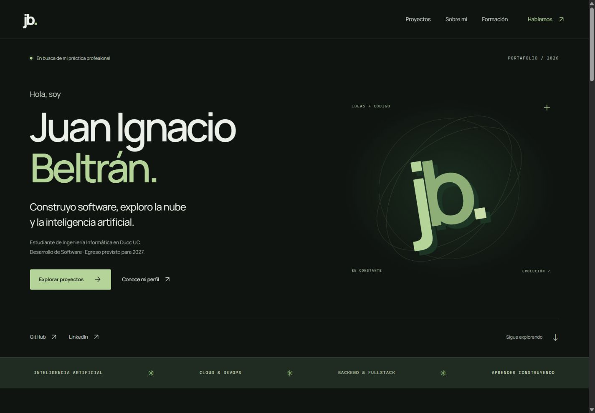
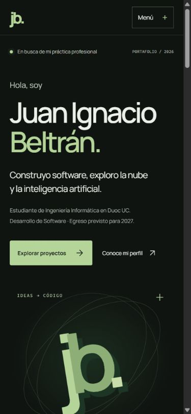

# Validación del rediseño

Comprobaciones realizadas el 20 de octubre de 2026:

- `npm run lint`: correcto, sin advertencias de código.
- `npm run typecheck`: correcto (también forma parte del build).
- `npm run build`: correcto; Vite 7.3.7.
- `git diff --check`: correcto.
- Build servido localmente en `/perfil-github/`: 17 recursos con HTTP 200 y tipos de contenido correctos, incluidos los tres PDF, dos WebP, CSS, JavaScript y fuentes.
- Demo de Country Clash: HTTP 200. Repositorios públicos consultados mediante el conector GitHub. LinkedIn conserva exactamente la URL proporcionada; no se verificó el contenido de ese perfil.
- Navegador: revisión visual de escritorio y móvil, y comprobación de ancho a 320, 390, 768 y 1440 px. Sin desbordamiento horizontal tras corregir el bloque de contacto y el ancho mínimo del documento.
- Menú móvil: apertura, cierre con Escape y cierre al seleccionar Formación.
- Detalles PokePeluche: apertura/cierre con Enter, con arquitectura y descripción accesibles.
- Anclas del build: todas resuelven a un elemento. Un solo `h1`. Certificados apuntan a los archivos emitidos por Vite.
- Imágenes del proyecto cargadas. Sin errores de consola en la revisión final.
- `prefers-reduced-motion`: regla CSS revisada; desactiva animaciones, transiciones y desplazamiento suave. No se simuló la preferencia del sistema.
- Archivos Cisco conservados en origen y ausentes del build. CV omitido porque no hay archivo disponible.

No se ejecutó una auditoría automática completa de accesibilidad ni Lighthouse. La configuración de GitHub Pages y el despliegue real quedan para la publicación aprobada.

## Capturas

[Página completa](screenshots/full-page.jpg). En esta captura, las imágenes que están fuera del viewport inicial pueden mostrar el estado inicial de su transición de entrada; al desplazarse se muestran con opacidad completa.
